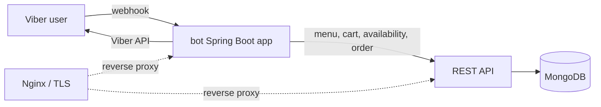
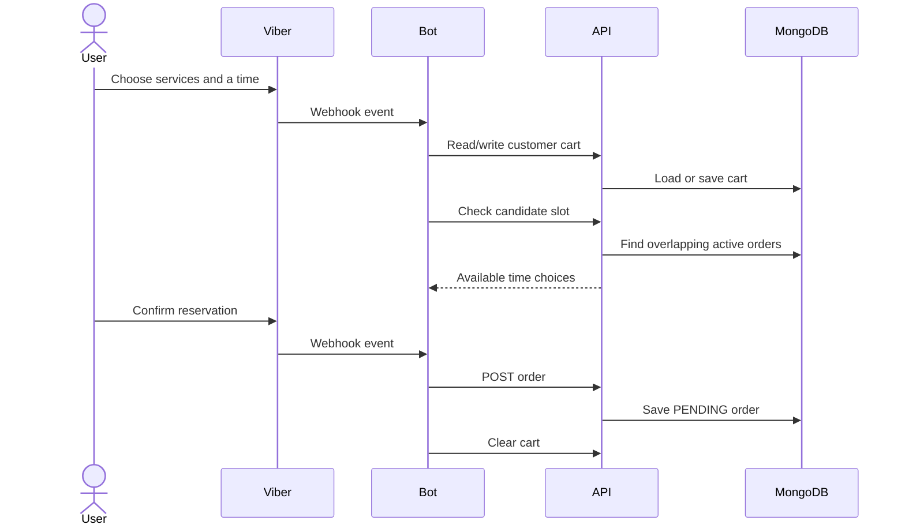

# Viber Reservation Bot and REST API

This repository contains a Java application for browsing a service menu and creating appointment reservations through Viber. A bot handles Viber webhook events and calls a Spring REST API; the API stores menu, customer-cart, and order documents in MongoDB. The project also contains a small Viber API client library and a legacy Nginx/Certbot deployment configuration.

The checked-in implementation is an older system and has material security and reliability limitations. It is suitable for source review and local development with synthetic data; it is not a production-ready deployment recipe.

## Verified features

- The Viber bot presents service categories, menu items, a cart, weekday date choices, and available time choices.
- Cart items are stored in MongoDB through the REST API.
- Reservation requests create `PENDING` orders after a separate availability check.
- The REST API exposes order status changes, including acceptance, decline, and completion.
- A scheduled job can send reminders for next-day orders.
- Nginx configuration proxies API and bot paths and serves TLS using mounted Certbot files.

The booking flow checks availability and then creates the order in separate requests. Concurrent users can therefore race for the same slot. The implementation does not make the check-and-create operation atomic.

## Architecture





## Modules and entry points

| Module | Responsibility | Entry point |
| --- | --- | --- |
| `services/bot` | Viber webhook controller, menu generation, HTTP calls to REST API, reminder scheduler | `payten.bot.BotApplication` |
| `services/restapi` | Menu, customer-cart, user, and order REST endpoints backed by Spring Data MongoDB | `com.payten.restapi.RestapiApplication` |
| `services/viberutil` | Viber API DTOs, keyboard/message builders, and HTTP client | `com.payten.viberutil.ViberBotManager` |
| `services/nginx` | Legacy reverse-proxy and Certbot deployment files | `services/nginx/conf/usluge.conf` |

The Maven reactor is `services/pom.xml`. It builds `viberutil`, `restapi`, and `bot` in dependency order. The bot depends on the Viber utility module and the REST service at runtime; the REST service depends on MongoDB.

## REST API

Menu and order controllers use the configured `rest.path` prefix (`/api/v1` by default). Customer cart endpoints use a fixed `/api/v1` prefix.

| Method and path | Purpose |
| --- | --- |
| `GET /api/v1/getallCategories` | List menu categories |
| `GET /api/v1/getCategoryItems/{category}` | List items in a category |
| `GET /api/v1/getItemByName/{name}` | Find a menu item by name |
| `POST /api/v1/addMenuItem` | Save a menu item |
| `PUT /api/v1/addItemToCart?viberId=…` | Add an item to a customer cart |
| `DELETE /api/v1/removeItemFromCart?viberId=…` | Remove an item from a cart |
| `PUT /api/v1/clearCart?viberId=…` | Archive and clear a cart |
| `GET /api/v1/checkFreeTimeSlots?localDate=YYYY-MM-DD&totalMinutes=…` | Return non-overlapping candidate slots during the configured 07:00–17:00 business window |
| `GET /api/v1/checkTimeSlotAvailability?start=…&end=…` | Check for an overlapping order |
| `GET /api/v1/getTotalTime?viberId=…`, `GET /api/v1/getTotalPrice?viberId=…` | Calculate the current cart's duration and price |
| `GET /api/v1/convertToOrderModel?viberId=…`, `GET /api/v1/checkIfCartIsEmpty?viberId=…` | Read cart contents and state |
| `POST /api/v1/addOrder` | Create an order |
| `GET /api/v1/getOrders` | List orders |
| `PUT /api/v1/acceptOrder/{id}` | Mark an order in progress |
| `PUT /api/v1/declineOrder/{id}` | Decline an order |
| `PUT /api/v1/clearCart/{id}` | Mark an order complete |
| `PUT /api/v1/updateStartTime?startDate=…&viberId=…` | Change an order's start time |
| `GET /api/v1/getAllUsers`, `GET /api/v1/getUser/{id}`, `GET /api/v1/getUsersByLocation/{location}`, `GET /api/v1/getAllLocations` | Read user records and locations |
| `POST /api/v1/addUser`, `PUT /api/v1/updateUser/{id}`, `DELETE /api/v1/deleteUser/{id}` | Create, update, and delete user records |

The bot receives webhooks at `VIBER_BOT_PATH` (default `/dentalcare-bot`) and exposes a `PUT` callback at that path plus `/updateStartTime` for merchant time changes.

## Requirements and local setup

- JDK 17 (the reactor compiles all modules with Java 17 compatibility)
- Maven 3.8.6 or later
- Docker Engine with the Compose plugin for the containerized REST API and MongoDB

From the repository root:

```sh
mvn -f services/pom.xml test
mvn -f services/pom.xml package -DskipTests
docker compose -f services/docker-compose.yml up --build
```

The local Compose stack starts MongoDB and the REST API on loopback port 9097. MongoDB has no host port mapping and is intended only for this local network. The bot is an optional profile:

```powershell
Copy-Item services/.env.example services/.env
docker compose --env-file services/.env -f services/docker-compose.yml --profile viber up --build
```

The bot needs a Viber token to send messages. Webhook registration is disabled by default. To register a webhook, provide a valid test bot token, a publicly reachable HTTPS callback base URL, and explicitly set `VIBER_REGISTER_WEBHOOK=true`. Starting the bot can then make a live Viber API call. Do not use production credentials for local testing. Without a Viber account and reachable callback, the REST API can still be developed and tested locally, but inbound Viber events cannot be exercised end to end.

For running services outside Compose, configure `MONGODB_URI` for the REST API and `REST_API_URL` for the bot. `VIBER_BOT_TOKEN` is required for sending Viber messages. The bot initializes its menu from the REST API at startup; set `bot.initialize-menu-on-startup=false` only for isolated context tests.

## Configuration

| Variable | Service | Purpose | Default |
| --- | --- | --- | --- |
| `MONGODB_URI` | REST API | MongoDB connection | `mongodb://localhost:27017/viberbot` |
| `REST_API_URL` | Bot | REST API base URL | `http://localhost:9097/api/v1` |
| `VIBER_BOT_TOKEN` | Bot | Viber API credential | Empty; configure outside source control |
| `VIBER_BOT_PATH` | Bot | Webhook path | `/dentalcare-bot` |
| `VIBER_WEBHOOK_BASE_URL` | Bot | Public callback base URL used only when registration is enabled | Empty |
| `VIBER_REGISTER_WEBHOOK` | Bot | Register callback during startup | `false` |
| `REMINDERS_ENABLED` | Bot | Enable scheduled reminder feature | `true` in app config; `false` in local Compose |

Copy `services/.env.example` to `services/.env` for Compose and replace placeholders locally. Never commit the real file.

The older split deployment Compose files require a separate environment file based on `services/restapi/.env.example`; they still use the legacy external Docker network and mounted TLS configuration. Operators must confirm all values and certificate mounts before using those deployment files.

## Tests and known limitations

The Maven reactor contains Spring context smoke tests and focused slot-availability tests. Tests should use only local defaults and mocks; no Viber call or production database is needed. The bot context test disables startup menu loading so it does not require a running API.

Known limitations include unauthenticated REST endpoints, user and order data returned by administrative endpoints, no webhook signature verification, plain-text PIN modeling, race-prone reservation creation, and limited validation/error handling across REST operations. The older Nginx and Certbot deployment files contain deployment-specific material and should not be used as a fresh deployment template. See [the security report](docs/SECURITY.md), [development notes](docs/DEVELOPMENT.md), and [interview guide](docs/INTERVIEW_GUIDE.md).
